# Codex Move 架构设计 (Architecture Design)

## 1. 产品定位与设计边界

**Codex Move（Codex 搬家）** 是一款面向非命令行普通用户的生产级跨平台桌面应用，专注于在两台电脑之间（Windows ↔ macOS、Windows ↔ Windows、macOS ↔ macOS）通过局域网直接完成 **OpenAI Codex（CLI 与 Desktop）** 的单次换机迁移。

### 核心承诺
- **零命令行依赖**：用户无需安装 Node.js、Python、Rust、Git，无需手动编辑 `config.toml`、`state_5.sqlite` 或 JSONL。
- **纯局域网点对点**：不依赖任何云服务、注册账号或第三方中转服务器；网络服务仅在用户进入连接/迁移向导时启动，离开或完成即销毁。
- **适配器隔离与能力协商**：通过版本化 `CodexAdapter` 识别实际 `.codex` 数据结构（SQLite schema 版本、JSONL 事件结构、`.codex-global-state.json`、Skills、Automations、Plugins 等），遇到未知 schema 绝不盲目猜测写入。
- **结构化跨平台路径映射**：基于最长有效路径前缀与路径组件边界，处理 Windows 盘符、UNC 路径、POSIX 分隔符、大小写敏感度及 Unicode NFC/NFD 归一化冲突。
- **默认保护凭据与目标环境**：默认不迁移 `auth.json`、系统钥匙串、`installation_id`、浏览器状态与锁文件；自动扫描并提示 `config.toml`、MCP 配置及 `.env` 中的潜在密钥；不自动执行任何导入的 hooks、MCP 或 Skill 脚本。
- **阶段检查点与可验证回滚**：跨 SQLite 数据库、JSONL 与项目目录的修改采用持久化事务日志（WAL/Journal）+ 备份快照 + 补偿回滚设计，确保任何阶段中断、断网或崩溃后均可安全回滚或恢复。

---

## 2. 系统总体架构

```mermaid
flowchart TB
    subgraph UI["前端界面 (TypeScript + React + CSS Variables)"]
        Home["首页: 发送 / 接收"]
        Conn["1. 连接与安全配对 (QR / PAKE连接码)"]
        Select["2. 迁移内容分类与敏感项确认"]
        Map["3. 新电脑项目位置与冲突处理"]
        Summary["4. 迁移摘要与Codex进程关闭检查"]
        Progress["5. 双阶段进度 (网络传输 / 本地导入)"]
        Result["6. 验证结果、待办确认与一键回滚"]
    end

    subgraph IPC["Tauri 2 安全 IPC 边界 (最小权限 Commands)"]
        Cmds["commands::* (强类型请求/响应 + 结构化错误)"]
    end

    subgraph Core["Rust 核心引擎 (src-tauri/src)"]
        Discovery["discovery: UDP组播 224.0.0.167:53317 + 局域网手动直连"]
        Pairing["pairing: TLS证书指纹绑定 + X25519/HKDF-SHA256 配对认证 + 限流退避"]
        Transport["transport: Axum Rustls HTTPS 双向能力协商 + 分块流式断点续传"]
        Inventory["inventory: CODEX_HOME 发现、10大类资产分类与敏感信息扫描"]
        Adapter["adapters::codex: 动态识别 state_*.sqlite / thread_history_*.sqlite / JSONL / GlobalState"]
        Paths["paths: 跨平台路径前缀树转换、保留名/大小写/Unicode/Symlink/Git Worktree检查"]
        Planner["planner: 合并去重、同ID分叉检测、配置字段级冲突保护、空间预检"]
        Migration["migration: 10阶段状态机 (Scan -> Snapshot -> Transfer -> Verify -> Plan -> Backup -> Apply -> Check -> Complete)"]
        Recovery["recovery: 持久化 Journal 日志、崩溃恢复检测、自动/手动补偿回滚"]
        Verify["verification: 哈希校验、SQLite integrity_check、外键与路径残留审计"]
    end

    UI <-->|"Tauri Invoke / Events"| IPC
    IPC <--> Core
```

---

## 3. 核心模块职责划分

| 模块路径 | 核心职责 |
| :--- | :--- |
| `src-tauri/src/errors` | 统一错误枚举 `AppError`，包含错误码、用户友好消息（中/英参数化）、可恢复性标记、诊断详情（自动脱敏）。 |
| `src-tauri/src/logging` | 基于 `tracing` 的结构化日志与内存诊断缓冲区，内置正则与字段名脱敏过滤器，严禁记录 Token、密钥或聊天正文。 |
| `src-tauri/src/config` | 集中式安全与资源限制配置（最大清单大小、最大文件数、路径长度上限、并发流限制、配对超时与尝试次数）。 |
| `src-tauri/src/platform` | 平台特定能力检测：Windows WebView2 运行时检测、Codex 活跃进程检测（不强制杀死）、磁盘可用空间查询、Symlink 权限探测。 |
| `src-tauri/src/adapters/codex` | 隔离 Codex 内部存储细节：动态发现 `state_*.sqlite`、`thread_history_*.sqlite`、`memories_*.sqlite`、`goals_*.sqlite`，验证 `_sqlx_migrations` 版本与表结构；解析 `sessions/**/*.jsonl`、`archived_sessions/**/*.jsonl.zst`、`session_index.jsonl`、`.codex-global-state.json`、`config.toml`。 |
| `src-tauri/src/inventory` | 扫描 `CODEX_HOME`（环境变量、默认位置、用户自定义目录）及 `~/.agents/skills`，输出 10 类标准清单条目与迁移状态标签（可直接迁移、需路径转换、需重新安装、需重新认证、暂不支持），并检测 `.env`/私钥/API Key。 |
| `src-tauri/src/paths` | 结构化跨平台路径引擎：处理 Windows `C:\`、UNC `\\server\share` 与 POSIX `/Users/...`；严格按路径组件边界做最长前缀替换；检测 NTFS/APFS 大小写冲突、Windows 保留设备名（`CON`, `NUL`, `AUX` 等）、尾随空格/点、NFC/NFD 冲突、内外部符号链接及 Git worktree/submodule。 |
| `src-tauri/src/planner` | 结合源清单与目标机器现状生成 `ImportPlan`：处理既有数据合并、完全相同会话去重、同 ID 分叉会话共存保护（重命名备份分支或并存归档，绝不按时间戳静默丢弃）、`config.toml` 字段级合并（保护目标机认证与本机路径）、Automations 默认设为 `paused`/`disabled`。 |
| `src-tauri/src/archive` | 流式安全归档与解包：支持按分块流式打包与解包，防御 Zip/Zstd 解压炸弹、路径穿越（`..`）、绝对路径注入和越界符号链接；支持使用 Argon2id + ChaCha20-Poly1305 导出加密离线迁移包（高级备用功能）。 |
| `src-tauri/src/discovery` | 遵循 LocalSend v2 发现思想（UDP Multicast `224.0.0.167:53317` + HTTP `/api/codex-move/v1/announce`），仅在进入配对页面时启动，广播内容仅含随机别名、OS 类型、架构、协议版本与 TLS 证书 SHA-256 指纹，绝不广播敏感信息。 |
| `src-tauri/src/pairing` | 零信任局域网配对：每次会话动态生成自签名 TLS 证书（`rcgen`），支持二维码（内含 IP:Port + 证书指纹 + 256-bit 一次性配对令牌）与高熵连接码 / SPAKE2 等价密钥协商机制，严格绑定对端 TLS 证书指纹，具备 5 次失败锁定与指数退避。 |
| `src-tauri/src/transport` | 基于 `axum` + `rustls` 的点对点 HTTPS 传输：首步执行 `/handshake/capabilities` 交换协议版本、迁移格式版本、Codex 适配器能力与文件系统约束；支持分块 SHA-256 校验与绑定 `(migration_id, manifest_hash)` 的断点续传。 |
| `src-tauri/src/migration` | 驱动 10 阶段状态机：Scan → Inspect → Snapshot（含源文件变动与写入锁复核）→ Transfer → VerifyStaging → Plan → BackupTarget → Apply（写持久化 Journal）→ VerifyResult → Complete。 |
| `src-tauri/src/recovery` | 维护 `.codex-move-journal/` 持久化事务日志与目标备份快照；支持启动时自动检测未完成迁移，提供一键回滚并逐文件校验哈希恢复。 |
| `src-tauri/src/verification` | 导入后多维验证：文件字节数与 SHA-256、SQLite `PRAGMA integrity_check`、会话 ID 与 `rollout_path` 存在性、旧机器路径残留扫描、Skills/AGENTS.md 完整性检查。 |

---

## 4. 关键技术决策说明

1. **为什么不直接复制整个 `.codex` 目录？**
   - `.codex` 中包含设备强绑定的 `auth.json`、`installation_id`、`cap_sid`、`.sandbox*`、`.plugin-appserver/*.exe`（平台特定二进制）、`logs_*.sqlite`（可达数十 MB 甚至数 GB 的调试日志）、`*-shm`/`*-wal` 锁文件等。直接跨系统覆盖会导致目标端登录失效、路径全部损坏、跨平台二进制报错甚至损坏目标端已有的聊天历史。
2. **为什么 SQLite 与 JSONL 必须协同处理？**
   - Codex 采用 `sessions/YYYY/MM/DD/rollout-*.jsonl` 存储不可变会话事件流，同时使用 `state_5.sqlite`（`threads`、`projects`、`project_roots`、`thread_attachments` 等表）与 `thread_history_1.sqlite`（`thread_turns`、`thread_items`）作为高速索引与投影，外加 `.codex-global-state.json` 维护桌面端项目绑定与侧边栏顺序。
   - 只复制 JSONL 会导致桌面端项目分组、自定义标题（`session_index.jsonl` / `threads.title`）和置顶状态丢失；只改 SQLite 不改 JSONL 头部 `session_meta.payload.cwd` 会在回放或 backfill 时产生路径不一致。
   - **Codex Move 策略**：完整保留历史聊天正文、命令记录与工具输出原文不篡改；结构化转换 SQLite 表（`threads.rollout_path`, `threads.cwd`, `project_roots.path`, `thread_attachments.payload`）、`session_meta.payload.cwd` / `runtime_workspace_roots` 以及 `.codex-global-state.json` 中的项目根路径映射。
3. **Windows WebView2 运行时策略**
   - Tauri 2 在 Windows 上依赖 Microsoft Edge WebView2 Runtime。虽然 Windows 10 (1803+) 与 Windows 11 默认预装，但在精简版系统或严格离线环境中可能缺失。
   - 我们在构建配置与发布文档中明确采用 **Bootstrapper（在线引导安装）+ 离线 Standalone 安装包说明** 双策略，并在启动检测与文档中如实告知运行时要求，绝不虚假宣称“零运行时依赖”。
